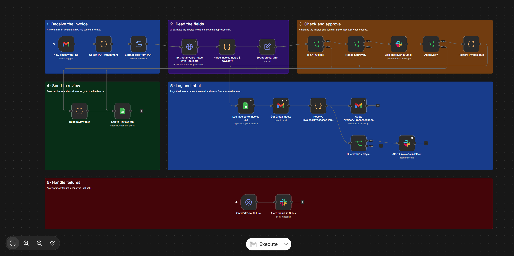

# Invoice Inbox: invoice emails to approved, logged and labelled (n8n)

An n8n workflow that watches a Gmail inbox for PDF invoices, reads the fields with an AI model, asks for approval in Slack when the amount is large, logs everything to Google Sheets, labels the email, and alerts Slack when a payment is due soon.

21 working nodes, grouped into 6 labelled sections so the canvas reads left to right, top to bottom.

## How it works

| # | Section | What happens |
|---|---|---|
| 1 | **Receive the invoice** | A Gmail trigger polls every minute for emails matching `has:attachment filename:pdf`. Up to 10 PDFs per email are picked out, and each PDF is turned into text. |
| 2 | **Read the fields** | The text goes to an AI model (`openai/gpt-4o-mini`, called through the Replicate API). It returns vendor, invoice number, total, currency and due date. A code step parses the answer and works out the days until due. An approval limit is set (default `5000`). |
| 3 | **Check and approve** | If the document is not an invoice, it goes to section 4. If the total is at or above the limit, Slack asks an approver (approve or reject, waits up to 24 hours). Smaller invoices skip approval. |
| 4 | **Send to review** | Non-invoices, rejected invoices and timed-out approvals are written to the `Review` tab of the sheet. |
| 5 | **Log and label** | Approved and small invoices are written to the `Sheet1` tab (matched on Message ID, so a re-run updates the row instead of duplicating it). The email gets the Gmail label `Invoices/Processed`. If the due date is 7 days away or sooner (overdue included), a Slack alert goes to `#invoices`. |
| 6 | **Handle failures** | An Error Trigger posts the workflow name, the last node that ran, the error message and the execution link to `#workflow-alerts`. |

## What you need

| Item | Detail |
|---|---|
| n8n | A recent version with the Gmail, Google Sheets, Slack, Extract From File and HTTP Request nodes |
| Gmail | An OAuth2 credential, and a label named exactly `Invoices/Processed` (the workflow stops with a clear error if it is missing) |
| Google Sheets | An OAuth2 credential and one spreadsheet with two tabs: `Sheet1` and `Review` |
| Slack | An API credential, plus channels `#invoices` and `#workflow-alerts` (rename them in the nodes if you like) |
| Replicate | An API token, stored as a Header Auth credential (`Authorization: Bearer <your token>`) |

### Sheet columns

`Sheet1` (the invoice log): `Processed At`, `Vendor`, `Invoice Number`, `Total Amount`, `Currency`, `Due Date`, `Days Until Due`, `Email Subject`, `From`, `Message ID`

`Review`: `Status`, `Processed At`, `Email Subject`, `From`, `File Name`, `Vendor`, `Total Amount`, `Currency`, `Message ID`

## Set it up

1. In n8n, create a new workflow and choose **Import from file**, then pick `workflow/invoice-inbox.json`.
2. Open each node that shows a missing credential (Gmail, Google Sheets, Slack, the Replicate request) and select your own credential.
3. In both Google Sheets nodes, replace `YOUR_GOOGLE_SHEET_ID` with the ID of your spreadsheet.
4. In Gmail, create the label `Invoices/Processed`.
5. In the workflow settings, set this workflow as its own **Error Workflow**, so failures reach the Slack alert in section 6.
6. Test with a few sample invoices before you rely on it.

## Things you may want to change

| Change | Where |
|---|---|
| Approval limit | Node `Set approval limit` (default `5000`) |
| "Due soon" window | Node `Parse invoice fields & days left` (`daysUntilDue <= 7`) |
| Which emails are picked up | Gmail trigger filter `has:attachment filename:pdf` |
| AI model or prompt | Node `Extract invoice fields with Replicate` |
| Slack channels | The three Slack nodes |

## Privacy note

Invoice text is sent to the Replicate API to be read by an AI model. Do not run real invoices through it unless that is acceptable for your data.

## What was removed from the export

Credentials, the original Google Sheet ID and link, webhook IDs and the instance ID were removed before publishing, so the file contains no private identifiers.

## Files

| Path | What it is |
|---|---|
| `workflow/invoice-inbox.json` | The workflow, ready to import |
| `images/workflow-overview.png` | The canvas, grouped into six sections |
