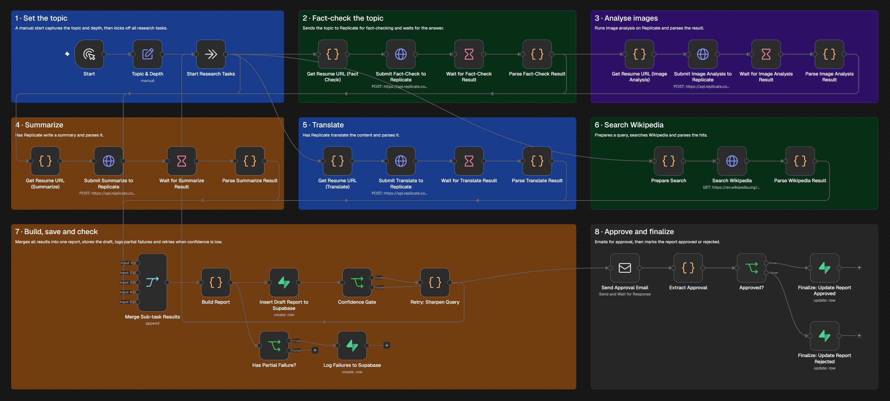

# Research Report Generator (n8n)

Takes a topic, runs five research tasks, stores a draft report in Supabase and asks for approval by email.

34 working nodes in 8 labelled sections.

**Status:** shared as a work in progress. This version has not had a verified end-to-end run, so test it before you rely on it.

## How it works

| # | Section | What happens |
|---|---|---|
| 1 | Set the topic | A manual start sets the topic, retry depth and an image URL |
| 2 | Fact-check | The model (`openai/gpt-4o-mini` through Replicate) rates confidence in the topic; the workflow waits up to 2 minutes for the callback |
| 3 | Analyse image | The model describes the image in relation to the topic |
| 4 | Summarize | The model writes a short summary of the topic |
| 5 | Translate | The model translates the topic text into Spanish |
| 6 | Search Wikipedia | Fetches the top 3 search hits |
| 7 | Build, save and check | Merges the results, saves a draft to `reports`, logs partial failures to `errors`, and retries up to 2 times if confidence is low |
| 8 | Approve and finalize | Sends an approve/reject email and updates the report status |

## What you need

| Item | Detail |
|---|---|
| Replicate | API token as a Header Auth credential (`Authorization: Bearer <your token>`) |
| Public n8n URL | Replicate calls the workflow back, so a localhost-only n8n will not receive the results |
| Supabase | Tables `reports` and `errors` with columns `id`, `topic`, `depth`, `image_url`, `search`, `image_analysis`, `summary`, `fact_check`, `translation`, `has_partial_failure`, `status` (JSON type for the five result columns) |
| Email | An SMTP credential; replace `you@example.com` in `Send Approval Email` |

## Known limits

| Limit | Detail |
|---|---|
| Not grounded | The fact-check and summary use only the topic text, not the Wikipedia results |
| Translation | Translates the topic, not the summary |
| Order | The tasks run one after another, not at the same time |
| Retries | Each retry saves another draft row |
| Approval | The approval email has no time limit |
| Request errors | A failed request to Replicate stops the run before the failure logging sees it |

The topic and image URL are sent to Replicate, so do not use private data.
